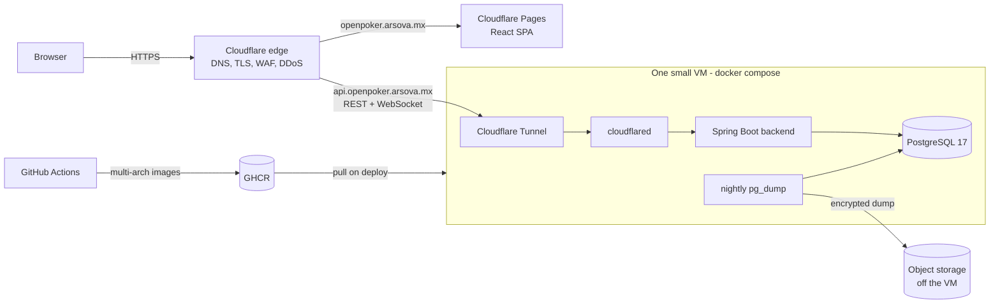

# Deploying OpenPoker

> **Status:** design document, October 2026. Nothing below is deployed yet except the frontend on Cloudflare Pages.
> Tracking issue: [#43](https://github.com/arsova-mx/OpenPoker/issues/43). Prices are USD, on-demand, checked on
> 2026-10-15 (sources at the end). Recheck them before you commit money.

OpenPoker has two audiences for deployment:

1. **The public instance** (`openpoker.arsova.mx`), a free service the maintainers run for anyone.
2. **Self-hosters**, who should be able to run the same thing on any machine with Docker.

The design below uses one artifact for both: the Docker images and `docker-compose.yml` from this repo. The public
instance is "just another self-hosted install" with Cloudflare in front, so it never drifts from what the
community runs, and it can move between providers in about an hour.

## 1. What the application needs

These constraints come from the code, not from preference:

| Constraint | Where it comes from | Consequence for hosting |
|---|---|---|
| **One always-on backend process** | The STOMP broker is Spring's in-memory simple broker; `WebSocketSessionRegistry`, the rate limiter and ticket timers keep state in memory | No horizontal scaling and no scale-to-zero. Two instances would split rooms; a cold start drops every live room |
| **Long-lived WebSockets** | Clients keep a STOMP connection to `/ws-native` for the whole session, with 4 s heartbeats | The platform must support WebSockets without a short request timeout. Rules out AWS App Runner (HTTP/1.1 only, 120 s request limit, stateless) and Lambda + API Gateway (would need a rewrite) |
| **JVM memory** | Spring Boot 4 on Java 21 | Plan for 512-768 MB for the backend. With PostgreSQL on the same host, **2 GB RAM is comfortable, 1 GB is tight** |
| **Small relational database** | PostgreSQL 17 + Flyway, kilobytes per session | A managed database is optional. PostgreSQL in a container with nightly off-site backups is enough for a long time |
| **Static SPA** | React build in `frontend/dist` | Any static host; it already runs on Cloudflare Pages for free |
| **Client IP for rate limiting** | `RateLimitFilter` uses `request.getRemoteAddr()` with `server.forward-headers-strategy=native` | The proxy in front of the backend must reach it from a private or loopback address so Tomcat trusts `X-Forwarded-For`. Never publish port 8080 to the internet |

## 2. Target architecture

- **Frontend** stays on Cloudflare Pages, built with `VITE_API_URL=https://api.openpoker.arsova.mx/api`.
- **Backend and database** run on one VM with the repo's `docker-compose.yml`, plus a `cloudflared` service. The
  tunnel makes an outbound connection to Cloudflare, so the VM has **no inbound ports open** (not even 80/443) and
  needs no TLS certificates.
- **CORS:** `ALLOWED_ORIGINS=https://openpoker.arsova.mx`. Authentication is a bearer token in a header (no
  cookies), so a separate API subdomain needs no cookie or CSRF changes.
- **Images** are built by CI for `linux/amd64` and `linux/arm64` and pushed to GitHub Container Registry (free for
  public repositories). All base images (`eclipse-temurin:21-*-alpine`, `nginx:alpine`, `node:22-alpine`,
  `postgres:17-alpine`) publish arm64 builds, so ARM machines (AWS Graviton, Oracle Ampere) work.
- **Backups:** nightly `pg_dump`, compressed and encrypted, copied off the VM, with a restore test before launch.

This layout is provider-neutral. The only provider-specific part is "a Linux VM with Docker".

## 3. Options compared

Monthly cost for the backend + database only (the frontend on Cloudflare Pages is free in every option).

### Free and low-cost platforms

| Option | Cost for this workload | Fits? | Why |
|---|---|---|---|
| **Oracle Cloud Always Free (Ampere A1 VM)** | **USD 0, no time limit** | **Yes** | 4 OCPU / 24 GB RAM (3,000 OCPU-hours + 18,000 GB-hours per month), 200 GB block storage, 10 TB/month egress, home region only. A real VM: always on, no WebSocket limits. Risks below |
| Hetzner Cloud CAX11 (ARM) / CX23 (x86) | EUR 5.99 / 5.49 per month (+ EUR 0.50 for an IPv4) | Yes | 2 vCPU / 4 GB. Cheapest paid VM found; prices rose on 2026-06-15 |
| Fly.io | USD 6.70/month for a 1 GB machine, database extra | Yes | No free tier for new organizations; managed Postgres starts at USD 38/month |
| Railway Hobby | USD 5 minimum, about USD 8-12/month estimated | Yes | Usage-based (about USD 10 per GB-month of RAM) |
| Google Cloud Run | About USD 47/month to keep one 1 vCPU / 1 GiB instance always on | Poor | WebSockets are cut at the request timeout (max 60 min). An open socket bills the instance as active. Below 1 vCPU, concurrency is forced to 1 |
| Azure Container Apps | About USD 10 (idle) to 33 (active) per month with one 0.5 vCPU / 1 GiB replica | Poor | Ingress documents a 240 s request timeout; its effect on WebSockets is unverified |
| Azure App Service F1 | Free | No | 5 WebSockets per instance, 60 CPU-minutes per day, no Always On |
| Render free | Free | No | Sleeps after 15 min without inbound traffic (WebSocket messages included), about 1 min to wake. Free Postgres expires after 30 days |
| Koyeb free | Free | No | 0.1 vCPU / 512 MB, scales to zero after 1 h idle |

Free managed PostgreSQL exists (Neon: 1 GB and 100 compute-hours per month with a 5-minute auto-suspend; Supabase:
500 MB, paused after a week without activity; Aiven: 1 GB, 20 connections). None is needed when the database runs
next to the backend, and a connection pool that never lets Neon suspend would exceed its 100 compute-hours (24/7 at
0.25 CU is about 180).

**Oracle Always Free, risks and mitigations:**

- *Idle reclamation:* Oracle can reclaim an Always Free instance that is idle for 7 days, meaning CPU (95th
  percentile), network **and** memory all stay under 20%. A JVM plus PostgreSQL on a right-sized VM (for example
  1 OCPU / 4-6 GB) keeps memory above 20%, so the three conditions don't all hold.
- *Account suspension:* accounts with no activity for 30+ days may be suspended. Real users and CD deploys count as
  activity; a monthly login is cheap insurance.
- *Capacity:* "Out of host capacity" errors happen in busy regions when creating A1 instances. Retry, or try another
  availability domain.
- *Upgrading to Pay As You Go* keeps Always Free resources free and removes some trial limits; whether it also
  exempts instances from idle reclamation is not stated in the current docs. If you upgrade, set a budget alert.
- *No SLA and a single VM:* keep backups at a **different** provider, and keep the AWS fallback below ready to
  restore into.

### Edge: Cloudflare (free plan)

- **Tunnel** (`cloudflared`): outbound-only, works without a public IP, supports IPv6-only hosts
  (`--edge-ip-version`). Offered at no cost since 2021.
- **WebSockets** are supported on every plan. Cloudflare's documented proxy idle timeout is 900 s and its read
  timeout 125 s. The web client sends STOMP heartbeats every 4 s, so connections stay active. Cloudflare can still
  drop connections when it restarts edge servers; the client reconnects after 5 s.
- **Pages `_redirects` cannot proxy to an external host**, so `/api` on the Pages domain can't reach the backend
  without a Worker. A separate `api.` hostname served by the tunnel is simpler and costs nothing.

### AWS, if the maintainers absorb the cost

Prices from the AWS Price List API for us-east-1, published 2026-10-06 (RDS) and 2026-10-12 (EC2), with 730 hours
per month.

| Option | What you get | USD / month | USD / year |
|---|---|---|---|
| **Lightsail 2 GB, IPv6-only + Cloudflare** | 2 vCPU, 2 GB, 60 GB SSD, 3 TB transfer, no public IPv4 | **9.81** | 117.72 |
| **Lightsail 2 GB** | Same, with a public IPv4 | 11.77 | 141.24 |
| Lightsail 1 GB | 2 vCPU, 1 GB, 40 GB. Tight for JVM + PostgreSQL | 6.86 | 82.32 |
| **EC2 t4g.small (Graviton), no public IPv4** | 2 vCPU, 2 GiB, 20 GB gp3, 10 GB of snapshots | **14.36** | 172.37 |
| EC2 t4g.small with a public IPv4 | Same + $0.005/h for the IPv4 address | 18.01 | 216.17 |
| EC2 t4g.micro all-in-one | 1 GiB. Tight | 11.88 | 142.58 |
| EC2 t4g.micro + RDS db.t4g.micro (20 GB) | Managed PostgreSQL, separate from the app | 24.40 | 292.82 |
| Fargate ARM (0.5 vCPU / 1 GB) + ALB + RDS db.t4g.micro | Fully managed, the "enterprise" shape | 57.96 | 695.55 |
| Aurora Serverless v2, 0.5 ACU minimum (database only) | Auto-pause to 0 ACU never triggers, because the backend's connection pool keeps connections open | 43.80 | 525.60 |

Notes:

- **AWS Free Tier:** accounts created after 2025-07-15 get USD 100 in credits at sign-up and up to USD 100 more for
  completing activities. The Free plan lasts 6 months or until the credits run out; credits must be used within 12
  months. Accounts inside an AWS Organization or Control Tower landing zone are **not eligible**. A new standalone
  account would cover roughly the first 6-12 months of the EC2 option, then billing starts.
- Lightsail bundles include the IPv4 address, storage and 2-3 TB of transfer at a fixed monthly price, which makes
  them the cheapest and most predictable AWS choice for this workload. EC2 is the choice if the team wants
  everything in CDK/CloudFormation with VPC-level control.
- The IPv6-only variants rely on Cloudflare serving IPv4 visitors. Check that every registry the VM pulls from
  (GHCR, Docker Hub) and `cloudflared` itself work over IPv6 before choosing them; otherwise pay for the IPv4.
- Not recommended for this workload: App Runner (no WebSockets, stateless), Lambda + API Gateway WebSockets (rewrite
  of the STOMP layer), ECS/Fargate + ALB + RDS (4-6x the cost for no benefit at a single instance).

## 4. Recommendation

**Run the public instance on an Oracle Cloud Always Free Ampere A1 VM behind Cloudflare, and keep AWS Lightsail as
the paid fallback.**

| Piece | Choice | Monthly cost |
|---|---|---|
| Frontend | Cloudflare Pages (already in place) | 0 |
| DNS, TLS, WAF, DDoS, tunnel | Cloudflare free plan | 0 |
| Backend + PostgreSQL | Oracle Always Free A1 VM (start at 1 OCPU / 6 GB), `docker compose` | 0 |
| Images and CI | GitHub Container Registry + GitHub Actions (public repository) | 0 |
| Backups | Nightly `pg_dump` to object storage at another provider (a few MB) | about 0 |
| Monitoring | Free external uptime check on the health endpoint | 0 |
| **Total** | | **0** |
| Fallback: Lightsail 2 GB instead of Oracle | Same compose file and tunnel, restore the latest dump | 9.81-11.77 |

Why:

- It is the only option that is **free with no time limit and fits the architecture**: an always-on JVM singleton
  with long-lived WebSockets. Serverless platforms either sleep (and lose in-memory rooms) or cost USD 10-47/month to
  keep one instance warm.
- **Cloudflare is already the DNS and frontend host**, and the tunnel removes inbound ports, TLS certificates and the
  public IPv4 charge.
- **Same artifact as self-hosters.** If Oracle reclaims the VM or suspends the account, the move to AWS is "create a
  Lightsail instance, start the compose file with the same tunnel token, restore the dump". The tunnel hostname
  doesn't change, so users notice only the downtime.
- **AWS, when the team pays:** Lightsail 2 GB costs USD 9.81-11.77/month (USD 118-141/year) and is fixed-price. Use
  EC2 t4g.small (USD 14.36-18.01/month) only if you need VPC-level control. Both can be defined in CloudFormation or
  CDK (`AWS::Lightsail::Instance`, `AWS::EC2::Instance`). Hetzner (about EUR 6/month for 4 GB) is cheaper if AWS
  isn't a requirement.

Worth applying to, since any grant lowers the cost further: **AWS Cloud Credits for Open Source** (OSI license
required; projects dominated by a single vendor may not qualify), **Cloudflare Project Alexandria** (plan upgrades
for OSS projects), and **Neon's open-source program** (up to USD 5,000 per year in credits, for self-hostable
Postgres projects that document running on Neon).

Revisit this decision when any of these is true: the VM sustains more than ~50% CPU or memory, a single region is
no longer acceptable, or the backend moves its in-memory state to a broker relay (which would allow two instances
and managed container platforms).

## 5. Rollout plan

Blocking work first. None of this is optional for a public launch.

1. **Make `main` deployable.** CI must be green on `main` with PostgreSQL, Spring Boot 4 and Flyway
   (`ddl-auto=validate`) restored ([#79](https://github.com/arsova-mx/OpenPoker/pull/79)), and the CI checks must be
   required before merging, so a red PR can't be merged again
   ([#53](https://github.com/arsova-mx/OpenPoker/issues/53)). The organization's `main-protect` ruleset applies to
   every repository of the organization, so the checks belong in a ruleset scoped to this repository.
2. **Production readiness of the app:** frontend P0 bugs ([#46](https://github.com/arsova-mx/OpenPoker/issues/46)),
   dependency and secret scanning ([#59](https://github.com/arsova-mx/OpenPoker/issues/59)), Docker hardening (non-root
   user, healthchecks, [#58](https://github.com/arsova-mx/OpenPoker/issues/58)), and a health endpoint (Spring Boot
   Actuator `health` only) for monitoring.
3. **Images:** a GitHub Actions workflow that builds multi-arch images on every push to `main` and on tags, and
   pushes them to `ghcr.io/arsova-mx/openpoker-backend` and `-frontend`.
4. **Production compose file:** `docker-compose.prod.yml` (or an override) that uses the GHCR images instead of
   `build:`, adds `cloudflared` and a backup job, sets memory limits, and doesn't publish any port.
5. **Provision the VM** with infrastructure as code (Terraform/OpenTofu for Oracle, CDK or CloudFormation for AWS):
   the VM, its firewall (no inbound rules), and a cloud-init script that installs Docker and starts the stack.
   Secrets (`JWT_SECRET`, `POSTGRES_PASSWORD`, the tunnel token) live in the provider's secret store or in a
   root-only `.env` on the VM, never in git.
6. **Cloudflare:** create the tunnel and the `api.openpoker.arsova.mx` hostname, add a WAF rate-limiting rule for
   `/api/auth/*` as a first line of defense, set `VITE_API_URL` in the Pages project and redeploy.
7. **Operations:** an external uptime check on the health endpoint (free tiers of UptimeRobot or Better Stack), a
   budget alert if the provider bills, and a restore drill from the latest backup.
8. **Continuous deployment:** after the first manual deploy, a workflow that, on a release tag, connects to the VM
   (SSH over the tunnel or the provider's session manager) and runs `docker compose pull && docker compose up -d`.
   A deploy restarts the backend, which drops live rooms for a few seconds; clients reconnect automatically after
   5 s, so deploy outside peak hours.

## 6. Self-hosting

Self-hosters need the same three things: Docker, the compose file, and something that terminates TLS in front of
port 3000 (the nginx container already proxies `/api` and `/ws-native` to the backend, so a single origin works).
Any reverse proxy that supports WebSockets will do: Caddy, Traefik, nginx, or a Cloudflare Tunnel.

- Set `ALLOWED_ORIGINS` to the public URL, and strong `POSTGRES_PASSWORD` and `JWT_SECRET` values.
- Keep port 8080 private. If the proxy runs outside Docker on the same host, it reaches the backend over loopback,
  which Tomcat trusts for `X-Forwarded-For`.
- Run one backend per database. Two replicas would split rooms between them.
- Back up the `db_data` volume with `pg_dump`, not by copying files while PostgreSQL runs.

## Sources (checked 2026-10-15)

- AWS Price List API, us-east-1 (EC2 on-demand Linux, public IPv4, EBS gp3, Lightsail, RDS PostgreSQL, Aurora
  Serverless v2, Fargate, ALB): `https://pricing.us-east-1.amazonaws.com/offers/v1.0/aws/`
- AWS Free Tier: <https://aws.amazon.com/about-aws/whats-new/2025/07/aws-free-tier-credits-month-free-plan/>,
  <https://repost.aws/knowledge-center/aws-free-tier-account-start-expire>
- AWS App Runner runtime limits: <https://docs.aws.amazon.com/apprunner/latest/dg/develop.html>
- Aurora Serverless v2 auto-pause: <https://docs.aws.amazon.com/AmazonRDS/latest/AuroraUserGuide/aurora-serverless-v2-auto-pause.html>
- Oracle Always Free: <https://docs.oracle.com/en-us/iaas/Content/FreeTier/freetier_topic-Always_Free_Resources.htm>,
  <https://www.oracle.com/cloud/free/faq/>
- Google Cloud Run: <https://cloud.google.com/run/pricing>, <https://docs.cloud.google.com/run/docs/triggering/websockets>
- Azure Container Apps: <https://learn.microsoft.com/en-us/azure/container-apps/billing>; App Service limits:
  <https://learn.microsoft.com/en-us/azure/azure-resource-manager/management/azure-subscription-service-limits>
- Fly.io: <https://fly.io/docs/about/pricing/>; Render: <https://render.com/docs/free>; Koyeb:
  <https://www.koyeb.com/docs/reference/instances>; Railway: <https://railway.com/pricing>
- Hetzner: <https://docs.hetzner.com/general/infrastructure-and-availability/price-adjustment/>
- Neon: <https://neon.com/pricing>, <https://neon.com/open-source>; Supabase: <https://supabase.com/pricing>; Aiven:
  <https://aiven.io/docs/products/postgresql/concepts/pg-free-tier>
- Cloudflare Tunnel: <https://developers.cloudflare.com/cloudflare-one/networks/connectors/cloudflare-tunnel/>;
  WebSockets: <https://developers.cloudflare.com/network/websockets/>; connection limits:
  <https://developers.cloudflare.com/fundamentals/reference/connection-limits/>; Pages redirects:
  <https://developers.cloudflare.com/pages/configuration/redirects/>
- OSS programs: <https://aws.amazon.com/blogs/opensource/aws-cloud-credits-for-open-source-projects-affirming-our-commitment/>,
  <https://blog.cloudflare.com/expanding-our-support-for-oss-projects-with-project-alexandria/>
